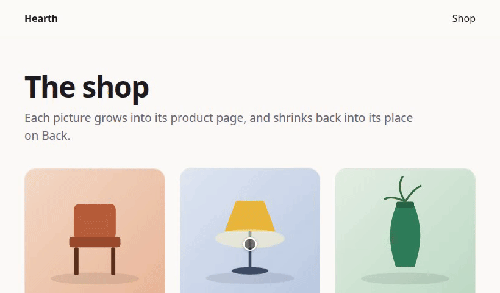
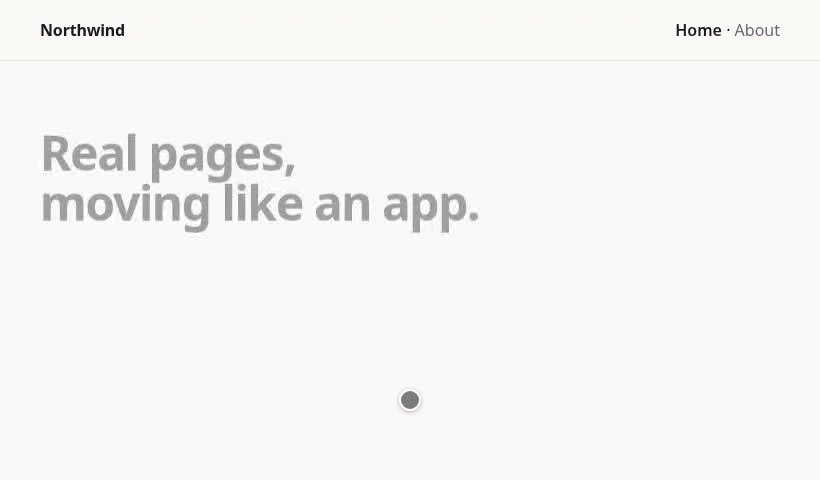
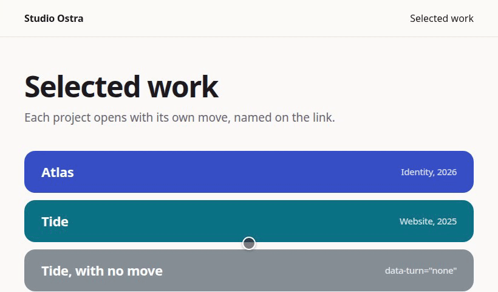
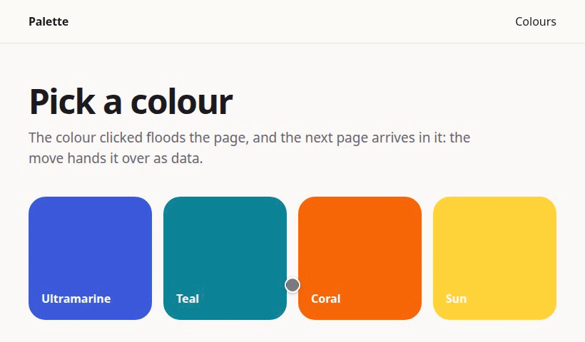
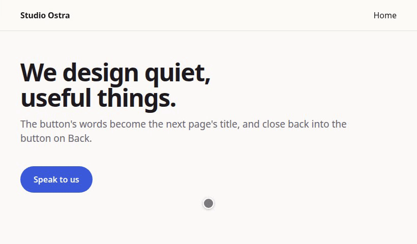

# pageturn

Page transitions between real page loads, the same in every browser.



pageturn plays a short animation as a page is left and another as the next one arrives.
The navigation between them is a real one: no client router, no swapped DOM. If anything
goes wrong, you get an ordinary page load.

- **Two tags and it works.** A stylesheet and a script in the head give every link of
  the site a default move. Where the browser has cross-document view transitions
  (Chrome, Edge, Safari 18.2+), the default move is handed to it. Elsewhere (Firefox)
  pageturn plays it itself.
- **Your own moves in CSS.** Name a move on a link. `<html>` then carries
  `data-turn-leaving` and `data-turn-arriving`, and your CSS animates them. The page is
  left when your animations end, so there is no duration to repeat in JavaScript.
- **Moves in code when you need them.** Run code before the page goes, hand data to the
  next page, and play a return when the visitor presses Back. Typed, and the same in
  every browser.
- **One element from a page to the next.** A picture grows into its product page, or a
  button's words become the next page's title, and they go back on Back.
  `data-turn-morph` in the markup is enough for the common case.
- **Small, and nothing to configure.** The head script is 1.5 kB gzipped and the whole
  classic script 4.2 kB. Nothing moves under `prefers-reduced-motion`, and no other host
  is contacted.

> **Status:** not published yet. What pageturn does in every situation is in
> [docs/contract.md](docs/contract.md).

## Contents

- [Quick start](#quick-start)
- [How it works](#how-it-works)
- [Examples](#examples)
  - [The default move](#1-the-default-move)
  - [A move named on a link](#2-a-move-named-on-a-link)
  - [A move that carries data](#3-a-move-that-carries-data)
  - [A picture that grows into its page](#4-a-picture-that-grows-into-its-page)
  - [Words that become a title](#5-words-that-become-a-title)
- [Guide](#guide)
  - [Tuning the default move](#tuning-the-default-move)
  - [When a leave and an arrival end](#when-a-leave-and-an-arrival-end)
  - [A page shown anew](#a-page-shown-anew)
  - [Moves in code](#moves-in-code)
  - [Back and Forward](#back-and-forward)
  - [Data in CSS](#data-in-css)
  - [The morph in code](#the-morph-in-code)
- [Reference](#reference)
- [Browsers](#browsers)
- [Questions](#questions)
- [Development](#development)

## Quick start

```sh
pnpm add pageturn     # or npm install pageturn, yarn add pageturn
```

### Astro

```js
// astro.config.mjs
import { defineConfig } from "astro/config";
import pageturn from "pageturn/astro";

export default defineConfig({
  integrations: [pageturn()],
});
```

Every same-origin link now plays the default move. The integration puts the head script
first in every page's `<head>`, so your own inline scripts can read
`window.pageturn.arrival`.

| Option | Default | Meaning |
| --- | --- | --- |
| `head` | `"inline"` | `"external"`: a script file, for a Content-Security-Policy with no inline script. `"manual"`: you render `pageturn/astro/Head.astro` yourself |
| `css` | `true` | `"no-native"`: pageturn plays the default move in every browser. `false`: no stylesheet, you write your moves |
| `prefetch` | `true` | `false`: pageturn's prefetch is left out, for a site that prefetches its own way |
| `morph` | `false` | `true`: [the morph](#4-a-picture-that-grows-into-its-page), from `data-turn-morph` or `defineMorph`. A list of paths (`["/products/*"]`): only those pages carry the head script's morph half |
| `defaultMove`, `leaveTimeout`, `stuckTimeout` | | as [`configure()`](#settings) |

The integration ships only what these options use. Your own scripts import from
`pageturn/core` (see [Entries](#entries)).

### Plain HTML, any server

```html
<head>
  <link rel="stylesheet" href="/pageturn.css">
  <script src="/pageturn.js"></script>
</head>
```

Copy both files from `node_modules/pageturn/dist/`. The script is a classic one, in the
head, without `defer` or `type="module"`: the arriving half has to run before the first
frame. The API is on `window.pageturn`, typed. Add `pageturn-morph.js` after it for
[the morph](#4-a-picture-that-grows-into-its-page).

This works in any layout that serves real pages: WordPress, Laravel, Rails, Django,
Eleventy, Hugo, and others. Astro is the only adapter today.

### With a bundler

The head script still goes in the head, inline or as a file, before the first frame:

```ts
// In your server's layout: the head script as a string, with its CSP hash.
import { headScript, headScriptHash } from "pageturn/head";
// <head><link rel="stylesheet" href="/pageturn.css"><script>${headScript}</script>...
```

or copy `node_modules/pageturn/dist/head.js` and load it with
`<script src="/head.js"></script>`. Then, in your bundle:

```ts
import "pageturn"; // the kernel, prefetch and the native hand-off
```

## How it works

```
 page A                                              page B
 ──────────────────────────────────────              ──────────────────────────────────
 click on a link
   │  a move is chosen (data-turn, chooseMove, match, or "page")
   ▼
 <html data-turn-leaving="project">                  head script, before the first frame:
   your CSS animates the page out                    <html data-turn-arriving="project">
   │  the animations end                               your CSS animates the page in
   ▼                                                   │  the animations end
 location.href = B ─── a real navigation ───────────▶  ▼
                                                     data-turn-arriving removed
```

pageturn has two halves.

- **The head script** runs before the first frame of every page. It works out how the
  page was reached, publishes it on `window.pageturn.arrival`, and marks `<html>`.
- **The kernel**, a module, handles clicks. It chooses a move, plays its leave, hands
  what the move carries to the next page through `sessionStorage`, then navigates.

Because the arriving mark is on `<html>` before anything paints, the page never shows at
rest for a frame before it arrives.

## Examples

Each example below is a few plain HTML pages in [`examples/`](examples/). To try them:

```sh
pnpm install
pnpm run examples    # builds, then serves http://localhost:4173/examples/
```

The recordings are made in Chromium by `pnpm run record`. Each example's steps are also
checked in Chromium and Firefox by `tests/examples/`.

### 1. The default move



Nothing on these pages asks for it. The stylesheet and the script are all there is:

```html
<head>
  <link rel="stylesheet" href="/pageturn.css">
  <script src="/pageturn.js"></script>
</head>
<body>
  <main>
    <h1>Real pages, moving like an app.</h1>
    <a class="button" href="/about.html">About us</a>
  </main>
</body>
```

`<main>` fades and shifts out, and the next page's `<main>` fades and shifts in. In
Chrome and Safari the browser plays it as a native view transition. The home page also
plays its own entrance the first time it is shown, from
[`data-turn-entering`](#a-page-shown-anew):

```css
html[data-turn-entering]:not([data-turn-arriving]) main > * {
  animation: rise 0.7s cubic-bezier(0.2, 0, 0, 1) both;
}
```

Source: [`examples/default/`](examples/default/).

### 2. A move named on a link



A named move needs no JavaScript: a `data-turn` attribute on the link, and CSS on each
side.

```html
<a href="/work/atlas.html" data-turn="project">Atlas</a>
<a href="/work/tide.html" data-turn="none">Tide, with no move</a>
```

```css
/* The page left */
html[data-turn-leaving="project"] main {
  animation: sink 0.35s cubic-bezier(0.4, 0, 1, 1) both;
}
@keyframes sink { to { opacity: 0; transform: scale(0.96); } }

/* The page reached */
html[data-turn-arriving="project"] .band { animation: unroll 0.6s both; }
html[data-turn-arriving="project"] .text { animation: rise 0.5s 0.2s both; }
```

The page is left once the animations `data-turn-leaving` started have ended.
`data-turn="none"` on a link, or on any ancestor (`<nav data-turn="none">`), lets it
navigate plainly. "← All work" has no attribute, so it plays the default move. The
example loads `no-native.css`, so the default move is pageturn's own in every browser.

Wrap the rules in `@media (prefers-reduced-motion: no-preference)` as the example does.
pageturn marks nothing under reduced motion, but it costs nothing to say so.

Source: [`examples/named/`](examples/named/).

### 3. A move that carries data



When the move depends on what was clicked, write it in code. Its `leave` runs before the
page goes, and what it returns crosses to the next page:

```js
// window.pageturn with pageturn.js; import { defineMove } from "pageturn" with a bundler.
pageturn.defineMove("tint", {
  match: ({ link }) => link.matches(".swatches a"),
  async leave(turn) {
    const tint = getComputedStyle(turn.link).getPropertyValue("--tint");
    const { left, top, width, height } = turn.link.getBoundingClientRect();
    const root = document.documentElement.style;
    root.setProperty("--tint", tint);
    root.setProperty("--x", `${left + width / 2}px`);
    root.setProperty("--y", `${top + height / 2}px`);
    await turn.leaving(); // plays the leaving CSS, resolves when it has ended
    return { data: { tint, light: tint === "#ffd43b" } };
  },
});
```

```css
/* The page left: the colour floods out from the click. */
html[data-turn-leaving="tint"]::after {
  content: ""; position: fixed; inset: 0; z-index: 2;
  background: var(--tint);
  clip-path: circle(0 at var(--x) var(--y));
  animation: flood 0.45s forwards;
}
@keyframes flood { to { clip-path: circle(150% at var(--x) var(--y)); } }
```

The page reached knows nothing of the colour. It reads it in CSS. The strings and numbers
in `data` become `--turn-<key>` on `<html>`, and the keys that are `true` become words of
`data-turn-with`, for as long as the page arrives:

```css
html[data-turn-arriving="tint"] { background: var(--turn-tint); animation: settle 0.6s both; }
html[data-turn-arriving="tint"]:not([data-turn-with~="light"]) .bar { color: #fff; }
@keyframes settle { to { background: var(--paper); } }
```

In a script, `pageturn.arrival` (or `arrival()`) answers
`{ move: "tint", via: "link", data: { tint, light }, ... }` from the first line of the
head on.

Source: [`examples/data/`](examples/data/).

### 4. A picture that grows into its page


One attribute, on both pages, and no script of your own:

```html
<head>
  <link rel="stylesheet" href="/no-native.css">
  <script src="/pageturn.js"></script>
  <script src="/pageturn-morph.js"></script>
</head>

<!-- The shop: every card may say it, the click says which -->
<a class="card" href="/lamp.html">
  
  <span>Brass lamp</span>
</a>

<!-- The product page -->

```

The picture is put on a layer above the page. The layer crosses the page change, travels
to the product picture's place, and is swapped for it. The crop opens instead of
stretching from one proportion to the other, and the corners follow. On Back it plays
backwards into its card, wherever the grid was scrolled. The second time, pageturn
remembers where the product picture was, so the layer travels before the page changes.

The rest of the page leaves and arrives under the morph's name, `product`, and
`product-back` on the way back:

```css
html[data-turn-leaving="product"] main { animation: fade 0.3s both; }
html[data-turn-arriving="product"] .details > * { animation: rise 0.5s 0.25s both; }
```

With Astro: `pageturn({ morph: true })`. With a bundler: `import "pageturn/morph/markup"`.

Source: [`examples/morph/`](examples/morph/).

### 5. Words that become a title



For anything beyond the markup's defaults, define the morph in code. Here a button's
label becomes the next page's title. The words are set again as real text at every
frame, so their size, weight and colour change, and the pill becomes the title's box:

```js
// The same script on both pages.
// With a bundler: import { back, defineMorph, text } from "pageturn/morph";
const { back, defineMorph, text } = window.pageturn.morph;

defineMorph("contact", {
  from: (link) => (link.matches(".cta .button") ? link : null), // what travels
  to: "h1.title",                                               // what it becomes
  as: text(),                                                   // words, not a picture
  use: [back()],                                                // and back on Back
});
```

```css
html[data-turn-leaving="contact"] main > :not(.cta) { animation: fade 0.3s both; }
html[data-turn-arriving="contact"] form { animation: rise 0.5s 0.35s both; }
```

The morph's other parts and options are in [The morph in code](#the-morph-in-code).

Source: [`examples/text/`](examples/text/).

## Guide

### Tuning the default move

```css
:root {
  --turn-leave-duration: 180ms;  /* default 200ms */
  --turn-arrive-duration: 320ms; /* default 280ms */
  --turn-shift: 0px;             /* default 8px; 0px fades only */
  --turn-easing: cubic-bezier(0.2, 0, 0, 1);
}
```

```html
<div data-turn-root> ... </div>  <!-- moves in place of <main> -->
```

`pageturn.css` lets the browser play the default move natively where it can. Load
`no-native.css` instead to have every browser play it pageturn's way. To have no default
move at all, `configure({ defaultMove: null })`: links nobody chose then navigate
plainly.

### When a leave and an arrival end

The page is left when the animations that `data-turn-leaving` started have ended. An
animation with a delay, or one meant to finish over the next page, can be cut short:
`--turn-leave-max` caps the wait, not the animation, which plays on while the next page
loads.

```css
html[data-turn-leaving="page"] { --turn-leave-max: 200ms; }
```

The arrival ends the same way. `data-turn-arriving` goes when the animations running on
the page have ended: those of the CSS and those a script started, including one started
after another. CSS transitions (a hover) and infinite animations are not waited for.
`--turn-arrive-max` caps that wait (10 s at most).

```css
html[data-turn-arriving="page"] { --turn-arrive-max: 1200ms; }
```

A page that is left stops arriving as its leave starts, so a leaving rule never has to
outrank an arriving one. A linter that checks descending specificity (Biome's
`noDescendingSpecificity`, Stylelint's `no-descending-specificity`) may still flag a
leaving rule written after a more specific arriving one for the same element. Put the
leaving rules first. The order changes nothing on the page.

A page can end its arrival sooner itself, or always itself with
`configure({ arrivalEnds: "manually" })`:

```ts
import { endArrival } from "pageturn";
endArrival("project"); // only if the page arrived as "project"; endArrival() for any
```

`window.pageturn.endArrival` does the same from an inline script. `pageturn:arrived` is
fired on `document` as the arrival ends, with `{ move, entering, whole }`. `whole` is
false when the arrival was cut short, by a leave or by `endArrival()`.

### A page shown anew

`data-turn-entering` is on `<html>` from the first frame when the page is shown anew.
That means reached by a link or the address bar, with a move or without. It is not set:

- after Back or Forward;
- in a frame;
- under reduced motion;
- when the page loads already scrolled (a reload, a link to a place in it). The mark is
  taken off before a frame shows the page scrolled.

A scroll that follows the visitor's own wheel, touch, key or press, or that comes after
the page has loaded, is the visitor's, and leaves the mark. It ends with the arrival. A
page's own entrance plays under it, and the selector says which moves it plays after:

```css
html[data-turn-entering]:is(:not([data-turn-arriving]), [data-turn-arriving="page"]) .hero {
  animation: hero-in 900ms both;
}
```

### Moves in code

```ts
import { arrival, defineMove } from "pageturn";

interface Box { left: number; top: number; width: number }

// What the move carries, declared once, for both pages.
export interface CardMove {
  data: Box;
}

// The same module on both pages.
defineMove<CardMove>("card", {
  // Which links play it.
  match: ({ link }) => link.closest("[data-card]") !== null,
  // The page left.
  async leave(turn) {
    const picture = turn.link.querySelector("img");
    if (!picture || !turn.canHandOver) return turn.decline(); // the default move plays
    const { left, top, width } = picture.getBoundingClientRect();
    turn.leaving();                                            // start the CSS half now
    await picture.animate(/* ... */).finished;
    return { data: { left, top, width } };
  },
  // The page reached, when it arrives under this name: as the module runs, and again
  // each time it is shown from the back/forward cache under it.
  arrive(arrival) {
    if (arrival.via === "link") { /* settle the picture from arrival.data, a Box */ }
  },
  // The page left, when it did not go: undo what leave changed.
  stay(turn, stay) {
    // stay.reason is "stuck" or "returned"; stay.handover is what leave answered.
  },
});
```

Which move plays, in this order:

1. a `data-turn` attribute on the link or an ancestor;
2. the choosers, `chooseMove((visit) => name | null | undefined)`, for a decision that
   spans moves. `null` means no move, and `undefined` passes;
3. the moves' `match`, in the order they were defined;
4. the default move, `page`.

`leave` may answer:

| Answer | What happens |
| --- | --- |
| nothing | The CSS half plays (if the move has not started it), then the page is left |
| `turn.decline()` | Declined. The default move plays instead |
| `{ data, arriveAs, returnAs, remember }` | The page is left now, with this for the next page |

What a move carries is declared in one type, `{ data, remember, report }`. `data` is for
the page reached, `remember` is kept with this history entry, and `report` is what the
page reached says through `whenLeft`. A field left out is any JSON. Interfaces are
accepted; a `Date`, a `Map` or a function is a type error.

A leave that throws, or that lasts longer than `leaveTimeout` (4000 ms), navigates with
no move. A navigation that has not completed after `stuckTimeout` (4000 ms) calls `stay`
with `reason: "stuck"`, and the page left can be used again. Every number of
milliseconds in JavaScript is written plain, with no unit. A time in CSS has its own.

`arrival()` answers the same anywhere, from a module or from an inline script before the
first frame:

```html
<script>
  const reached = window.pageturn?.arrival;
</script>
```

### Back and Forward

A page cannot delay a Back, so the page left by Back never plays a leave. The page
returned to can play a return, if the move that left it asked for one:

```ts
defineMove("card", {
  async leave(turn) {
    /* ... */
    return {
      data: { /* for the page reached */ },
      returnAs: "card-back",            // how this page arrives if returned to
      remember: { scrollTop: scrollY }, // kept with this history entry
    };
  },
});
```

On the page that will be left by Back:

```ts
import { whenLeft } from "pageturn";

whenLeft(() => ({ box: boxOf(heroPicture) })); // runs in pagehide: keep it cheap
```

When there is nothing to return to (the picture was scrolled out of view), say so, and
the first page comes back plain:

```ts
whenLeft((leaving) => (isInView(heroPicture) ? { box: boxOf(heroPicture) } : leaving.decline()));
```

Back on the first page, within 3 s, `arrival()` is
`{ move: "card-back", via: "history", data: null, remembered: { scrollTop }, reported: { box } }`.
A move defined as `card-back` is told it by its `arrive`: after a reload as the module
runs, and from the back/forward cache as the page is shown. One place handles both.

As a page enters the back/forward cache, its arrival ends: `data-turn-arriving` is
removed and `arrival()` answers `null`. Shown again, the page is either plain or arrives
anew under the `returnAs` of the move that left it.

The default move plays no return in pageturn's own rendering. The browser may already
have animated a swipe back, and is restoring the scroll position at that moment.

### Data in CSS

The strings and numbers at the top of a move's `data` are custom properties on `<html>`
while the page arrives. `data: { tone: "teal" }` is `var(--turn-tone)`. The keys that are
`true` are words of `data-turn-with`: `data: { hadHeader: true }` is
`[data-turn-with~="hadHeader"]`. They go when the arrival ends, and are set again on a
return from the back/forward cache. By Back, what the entry remembered and what the page
left reported are carried the same way.

### The morph in code

`pageturn/morph` moves one element from the page left to its place on the page reached.
You say which element and where it lands. Everything past that is a part you import
when you need it:

```ts
import { back, defineMorph, linkBack, peek, seen, text } from "pageturn/morph";

defineMorph("photo", {
  from: (link) => (link.matches(".gallery a") ? link.querySelector("img") : null),
  to: ".lightbox img",
  find: seen(),            // travel before the page changes, to where it was last seen
  use: [
    back(),                // backwards on the browser's Back
    linkBack({ match: ({ link }) => link.matches(".lightbox .close") }), // and on a link back
  ],
});
```

| Part | What it adds | gzipped |
| --- | --- | --- |
| the core | A picture, cropped and never stretched, from one page to the next | 5.3 kB |
| `seen()`, `here()`, `peek()` | Where the element lands, known before the page changes | 0.2–0.6 kB |
| `back()` | Plays backwards on the browser's Back | 1.3 kB |
| `linkBack()` | Plays backwards on a link back, even from a page opened directly | 1.5 kB |
| `text()` | The layer is the words, set again at every size, with their box | 1.5 kB |
| `copy()`, `turned()`, `shadow()`, `behind()` | A copy of a whole card, a turned element, a shadow, the page behind shown early | 0.2–0.6 kB |

The whole guide, with every option, is [docs/morph.md](docs/morph.md).

## Reference

### On `<html>`, for your CSS

| Mark | When |
| --- | --- |
| `data-turn-leaving="<move>"` | While the page is left by that move |
| `data-turn-arriving="<move>"` | While the page arrives by that move, from its first frame |
| `data-turn-entering` | While the page is [shown anew](#a-page-shown-anew) |
| `data-turn-with="<keys>"` | The `true` keys of the arrival's data |
| `--turn-<key>` | The string and number keys of the arrival's data |

### In your markup

| Attribute | Meaning |
| --- | --- |
| `data-turn="<move>"` on a link or an ancestor | This move plays. `"none"`: the link navigates plainly |
| `data-turn-root` | What the default move moves, in place of `<main>` |
| `data-turn-morph="<name>"` | The element that travels and the one it becomes (`pageturn-morph.js` or `pageturn/morph/markup`) |
| `data-turn-back="<name>"` | A link back that plays the morph `<name>` backwards (with `linkBack()`) |

### Custom properties

| Property | Default | Meaning |
| --- | --- | --- |
| `--turn-leave-duration` | `200ms` | The default move's leave |
| `--turn-arrive-duration` | `280ms` | The default move's arrival |
| `--turn-shift` | `8px` | How far the default move shifts `<main>` |
| `--turn-easing` | | The default move's easing |
| `--turn-leave-max` | | The longest the leave is waited for |
| `--turn-arrive-max` | | The longest the arrival is waited for (10 s at most) |

### JavaScript

| Function | Does |
| --- | --- |
| `defineMove(name, { match, leave, arrive, stay })` | Defines a move. Returns a function that removes it |
| `chooseMove((visit) => name \| null \| undefined)` | Chooses a move for a click, before the moves' `match` |
| `arrival()` | How this page was reached: `{ move, via, from, data, remembered, reported }`, or `null` |
| `endArrival(move?)` | Ends the arrival now |
| `whenLeft((leaving) => report)` | What this page reports as it is left, for a return |
| `configure(settings)` | The [settings](#settings) |
| `defineMorph(name, options)` | One element from a page to the next (`pageturn/morph`) |

Without a bundler, the same functions are on `window.pageturn`, and the morph's on
`window.pageturn.morph`.

### Settings

```ts
import { configure } from "pageturn";

configure({
  defaultMove: "page",         // null: links nobody chose navigate normally
  prefetch: true,              // ask for the page as its link is pressed
  leaveTimeout: 4000,          // a leave longer than this navigates with no move
  stuckTimeout: 4000,          // a navigation longer than this puts the page back
  arrivalEnds: "animations",   // "manually": only endArrival() ends it
});
```

When the next page takes longer than `stuckTimeout`, the page left is put back (`stay`,
`pageturn:stayed`) and can be used again. If the page then comes after all, it still
arrives by its move. The time counts from the navigation's start. On a site whose server
can take longer than 4 s to answer, raise it.

### Events

All three are dispatched on `document`, for code that is not a move (a menu to close, a
scroll layer to stop):

| Event | When | `detail` |
| --- | --- | --- |
| `pageturn:leaving` | A move starts. Cancelable: the link then navigates plainly | the turn |
| `pageturn:stayed` | The page left was put back | `{ turn, stay }`, `stay.reason` being `"stuck"` or `"returned"` |
| `pageturn:arrived` | The arrival ended | `{ move, entering, whole }` |

### Entries

| Import | Content |
| --- | --- |
| `pageturn` | Everything below, in one |
| `pageturn/core` | The kernel and the API: `defineMove`, `chooseMove`, `arrival`, `endArrival`, `whenLeft`, `configure` |
| `pageturn/prefetch` | Prefetch on press. Imported for its effect |
| `pageturn/native` | The native hand-off of the default move. Imported for its effect; needs `pageturn.css` and the full head script |
| `pageturn/head` | The head scripts as strings, with their CSP hashes |
| `pageturn/morph` | One element from a page to the next. See [docs/morph.md](docs/morph.md) |
| `pageturn/morph/markup` | The morph from `data-turn-morph`. Imported for its effect |
| `pageturn/router` | The engine for client routers' navigations, which adapters drive. See [docs/router.md](docs/router.md) |
| `pageturn/testing` | For browser tests of a morph: the layer's parts by name, a travel held at a time or at its end |
| `pageturn/astro` | The Astro integration |

And the files of `dist/` for a page with no bundler: `pageturn.css` or `no-native.css`,
`pageturn.js` and `pageturn-morph.js`. `head.js` is the head script alone.

A site that turns prefetch off and writes its own moves imports `pageturn/core` only. The
kernel needs the head script: without it, it does nothing, and links navigate normally.

### Content-Security-Policy

- `script-src 'self'`: load `pageturn.js` as a file, or use `head: "external"` in Astro.
- Inline, with a hash:

  ```ts
  import { headScript, headScriptHash } from "pageturn/head";
  const policy = `script-src 'self' '${headScriptHash}'`;
  ```

  `coreHeadScript` and `coreHeadScriptHash` are the head script without its native half,
  for pages that do not load `pageturn.css`. With Astro's `security.csp`, the integration
  adds the hash of the one it uses.

pageturn sets no inline style and contacts no other host. `pageturn/morph` is the
exception: its layer is styled from script, through the DOM, which a `style-src` without
`'unsafe-inline'` allows. A site with Trusted Types has to allow its `innerHTML`.

## Browsers

| | Chrome, Edge 126+ | Safari 18.2+ | Firefox |
| --- | --- | --- | --- |
| The default move, `pageturn.css` | native view transition | native view transition | pageturn |
| The default move, `no-native.css` | pageturn | pageturn | pageturn |
| Named moves, moves in code, the morph | pageturn | pageturn | pageturn |

Older browsers get pageturn's own rendering where they run its script, and plain
navigation otherwise. Every change is tested in Chromium and Firefox, and in WebKit in
CI. What automation cannot see, such as a real return from the back/forward cache, is
checked by hand before each release ([docs/release-checklist.md](docs/release-checklist.md)).

## Questions

**Does it work with Next.js, Nuxt, SvelteKit?** Not yet on the links their router
handles: those do not load a page. `pageturn/router` is the engine for them, with the
same moves and CSS; the adapters that connect each router are not written yet
([docs/router.md](docs/router.md)).

**What if JavaScript fails, or the next page is slow?** The click is a real navigation.
A leave that throws or takes too long navigates anyway. A page that does not come in
time is put back, usable, and still arrives by its move if it comes later.

**A click in the first moments of a page navigates plainly.** The kernel is a module,
and a click before it has run is a plain navigation. `<link rel="modulepreload">` on its
file shortens that window. The arriving half, in the head, is never late.

**Prefetch fetches every page twice.** Prefetch only helps when pages are served with
cache headers (`ETag` or `Cache-Control`). Without them, Firefox and Safari fetch the
page twice. Switch it off with `configure({ prefetch: false })`, or `prefetch: false` in
Astro.

**Scroll, focus, screen readers?** Untouched: each page is a real page load. With the
morph's way back, the focus goes back to the link the visitor left from.

**Reduced motion?** Under `prefers-reduced-motion: reduce`, nothing is marked and links
navigate normally. The native transition is off too.

## Development

```sh
make install
make check     # Biome, the build, and TypeScript
make test      # Playwright in Chromium, Firefox and WebKit; make test PROJECT=firefox
make size      # fails above the gzipped size targets
pnpm run examples   # the examples, on http://localhost:4173/examples/
pnpm run record     # films the examples into docs/media/ (needs ffmpeg)
```

Releases are made with [Changesets](https://github.com/changesets/changesets): see
[docs/release-checklist.md](docs/release-checklist.md).

## License

MIT
